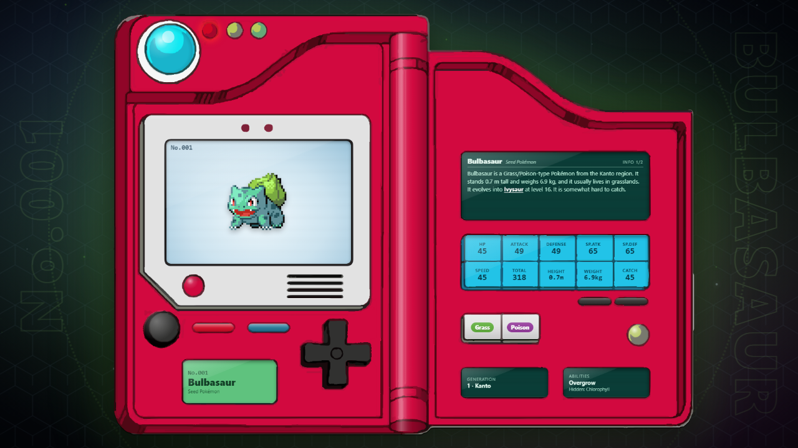

# Pokédex Gen 1-3 – Lively Wallpaper

An animated Pokédex wallpaper for [Lively Wallpaper](https://www.rocksdanister.com/lively/) featuring all 386 Pokémon from generations 1–3.

## Installation
1. Download this repo as a ZIP (Code → Download ZIP).
2. In Lively, click **+ Add Wallpaper** and select the ZIP file (or `index.html`).

## Customization
- Put your own images in the `images` folder, named by Pokédex number: `001.png` … `386.png` (`.gif`, `.webp` and `.jpg` also work).
- Lively settings: size, autoplay, seconds per Pokémon, random jump, and animated background.

## Disclaimer
Pokémon and all related names and images are trademarks of Nintendo, Game Freak and The Pokémon Company. This is an unofficial fan project, not affiliated with or endorsed by them.
